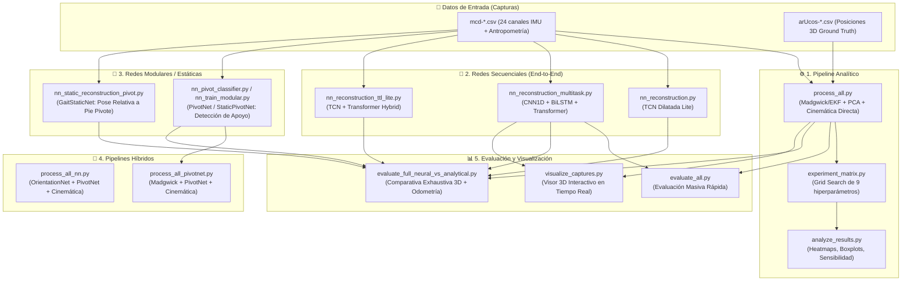

# 📚 Guía Completa de Códigos del Proyecto: GaitTrackingProject
> **Sistema de Captura de Movimiento (MoCap) y Reconstrucción Cinemática 3D de la Marcha Humana basado en IMUs y Deep Learning.**

---

## 🧭 1. Resumen General del Proyecto y Arquitectura

El objetivo del proyecto es reconstruir la pose 3D y la trayectoria global de la marcha humana del tren inferior utilizando únicamente **4 sensores inerciales (IMUs)** montados en el cuerpo (Muslo Derecho `RF`, Muslo Izquierdo `LF`, Pantorrilla Derecha `RT`, Pantorrilla Izquierda `LT`) y **3 medidas antropométricas** (longitud de fémur, longitud de tibia y ancho de cadera).

Como referencia de verdad terreno (**Ground Truth / GT**), se utilizó un sistema de visión por computadora basado en **marcadores ArUco** colocados en articulaciones clave (caderas, rodillas y tobillos).

El proyecto evolucionó a través de dos grandes vertientes:
1. **Enfoque Analítico Clásico:** Filtros de orientación (Madgwick / EKF), alineación geométrica (Rodrigues, PCA), interpolación esférica (Slerp) y cinemática directa con heurística de pie pivote.
2. **Enfoque de Deep Learning (Redes Neuronales):**
   - **Modelos Secuenciales End-to-End:** Estiman pose 3D y odometría global directamente desde la serie temporal de las IMUs (BiLSTM + Transformer, TCN Dilatada, TTL Híbrido).
   - **Modelos Modulares / Estáticos:** Redes que desacoplan el problema en (a) clasificar el pie de apoyo (`PivotNet` / `GaitStaticPivotNet`) y (b) estimar la pose relativa respecto al pie de apoyo (`GaitStaticNet`).

---

## 🗺️ 2. Mapa del Flujo de Datos y Relación entre Scripts

---

## 📖 3. Detalle de Cada Archivo de Código

---

### 🟢 1. Pipeline Analítico y Procesamiento Clásico

#### 📄 [process_all.py](file:///home/moybadajoz/Documents/GaitTrakingProyect/process_all.py)
* **¿Qué es?:** Es el script principal del **pipeline analítico tradicional**. Contiene toda la lógica matemática de procesamiento de señales, cinemática directa y cálculo de errores biomecánicos.
* **¿Qué hace paso a paso?:**
  1. **Lectura y Filtrado:** Lee archivos `mcd-*.csv` y `arUcos-*.csv`. Aplica un filtro pasa-bajas Butterworth de fase cero (`filtfilt`) a las lecturas inerciales.
  2. **Estimación de Orientación:** Ejecuta algoritmos de fusión sensorial (**Madgwick** o **EKF**) para obtener cuaterniones de orientación para cada sensor (`RF`, `LF`, `RT`, `LT`).
  3. **Alineación Espacial y Calibración:**
     - Usa la fórmula de rotación de Rodrigues con las primeras muestras en reposo para alinear el eje vertical con la gravedad.
     - Aplica **PCA (Principal Component Analysis)** sobre los datos en movimiento para alinear el eje de avance (Yaw) de la marcha.
     - Realiza interpolación esférica (**Slerp**) entre las orientaciones de los muslos para derivar la orientación de la pelvis/cadera.
  4. **Cinemática Directa y Pie Pivote (`mcd_reconstruction`):**
     - Evalúa cuál pie actúa como ancla/pivote (fase de apoyo o *stance*) comparando la altura Z relativa y la velocidad angular del giro de la pantorrilla (*swing override*).
     - Propaga la cadena esquelética sumando los vectores óseos rotados (fémures y tibias) desde el pie de apoyo hacia la cadera y hacia la pierna contraria en balanceo.
  5. **Métricas de Evaluación:** Sincroniza temporalmente con ArUco e interpola para calcular:
     - Error Euclidiano medio 3D (MPJPE).
     - Error Absoluto Medio (MAE).
     - Correlación de Pearson en trayectorias.
     - Ángulo de flexión/extensión de rodilla.
     - Detección de longitud y cadencia de zancadas (`detect_stride_lengths`).
     - Error de desplazamiento global acumulado.
  6. **Animación/Visualización:** Incluye una función `animation()` para renderizar en 3D el esqueleto analítico vs ArUco.

---

### 🧪 2. Optimización de Parámetros y Análisis Estadístico

#### 📄 [experiment_matrix.py](file:///home/moybadajoz/Documents/GaitTrakingProyect/experiment_matrix.py)
* **¿Qué es?:** Script de búsqueda en cuadrícula (**Grid Search**) para optimizar los 9 hiperparámetros clave del pipeline analítico (`process_all.py`).
* **¿Qué evalúa?:**
  1. Frecuencia de corte Butterworth (`CUTOFF_FREQS`: [5, 7, 9, 11] Hz).
  2. Orden del filtro (`FILTER_ORDERS`: [4, 5, 6]).
  3. Percentil PCA para detección de avance (`PCA_PERCENTILES`: [5, 10, 20, 30]%).
  4. Ganancia del filtro Madgwick (`MADGWICK_GAINS`: [0.01, 0.02, 0.033]).
  5. Recorte de interpolación Slerp en cadera (`SLERP_CLIP_MINS`: [0.3, 0.5]).
  6. Muestras estáticas de calibración (`CALIBRATION_SAMPLES_LIST`: [60, 70, 80, 100]).
  7. Filtro de orientación (`FUSION_FILTERS`: Madgwick vs EKF).
  8. Umbral de altura para cambio de pivote (`PIVOT_HEIGHT_THRESHOLDS`: [0.005, 0.01, 0.015] m).
  9. Umbral de velocidad angular para *swing override* (`SWING_VELOCITY_THRESHOLDS`: [0.3, 0.5, 0.7] rad/s).
* **Salida:** Ejecuta cientos de combinaciones usando procesamiento paralelo (`multiprocessing.Pool`) y guarda los resultados en `Results/experiment_matrix/experiment_matrix.csv`.

#### 📄 [experiment_matrix_tcn.py](file:///home/moybadajoz/Documents/GaitTrakingProyect/experiment_matrix_tcn.py)
* **¿Qué es?:** Matriz de experimentación y Grid Search para la red neuronal **TCN Lite** (`nn_tcn_lite.py`).
* **Hiperparámetros explorados:**
  1. `lr`: Tasa de aprendizaje (`1e-3, 5e-4, 1e-4`).
  2. `batch_size`: Tamaño del batch (`16, 32, 64`).
  3. `window_size`: Longitud de ventana temporal (`100, 150, 200` frames).
  4. `window_stride`: Desplazamiento/solapamiento (`15, 25, 50` frames).
  5. `n_test_subjects`: Número de sujetos en el conjunto de prueba (`2, 4`).
  6. `n_val_subjects`: Número de sujetos en validación (`2, 3`).
* **Salidas en `nn-results/experiment_matrix_tcn/`:**
  - Archivo de registro: `experiment_matrix_tcn.csv`.
  - Curvas de impacto marginal: `plots/hyperparam_trends.png`.
  - Mapas de calor 2D: `heatmaps/heatmap_lr_vs_batch_size.png`, `heatmaps/heatmap_window_size_vs_stride.png`.
  - Tabla del Top 10 mejores modelos: `summary_table.png`.

---

### 🧠 3. Modelos de Deep Learning (Redes Neuronales)

Todos los modelos y checkpoints se organizan de forma centralizada en la carpeta `nn-results/<tipo>/checkpoints/`.

#### 📄 [nn_tcn.py](file:///home/badajoz/Documents/GaitTrakingProyect/nn_tcn.py)
* **Arquitectura:** `GaitMultiTaskNetTCN` = **Backbone TCN Causal Dilatada (Temporal Convolutional Network)** con capacidad extendida (64 a 128 canales), conexiones residuales y cabezal multitarea (Pose 3D + Desplazamiento pélvico).
* **Propósito:** Reconstrucción cinemática 3D continua de alta capacidad representativa sin restricciones de modelo reducido.
* **Salidas:** Pose 3D de 6 articulaciones (18 valores) + traslación frame a frame `[dx, dy, dz]`.
* **Directorio de salida:** `nn-results/tcn/` (checkpoints en `nn-results/tcn/checkpoints/best_tcn.pt`).

#### 📄 [nn_tcn_lite.py](file:///home/badajoz/Documents/GaitTrakingProyect/nn_tcn_lite.py) *(anteriormente nn_reconstruction.py)*
* **Arquitectura:** `GaitMultiTaskNetTCN` = **Backbone TCN Causal Dilatada (Temporal Convolutional Network)** con conexiones residuales y cabezal multitarea (Pose 3D + Desplazamiento pélvico).
* **Propósito:** Reconstrucción cinemática 3D completa y continua del tren inferior con baja latencia y alta eficiencia temporal.
* **Salidas:** Pose 3D de 6 articulaciones (18 valores) + traslación frame a frame `[dx, dy, dz]`.
* **Directorio de salida:** `nn-results/tcn_lite/` (checkpoints en `nn-results/tcn_lite/checkpoints/best_tcn_lite.pt`).

#### 📄 [nn_tcn_lite_cv.py](file:///home/badajoz/Documents/GaitTrakingProyect/nn_tcn_lite_cv.py)
* **Arquitectura:** `GaitMultiTaskNetTCN` con protocolo robusto para dataset pequeño.
* **Características especiales:**
  1. **5-Fold Grouped Cross-Validation:** Partición agrupada por sujeto con reporte de `mean ± std`.
  2. **Stochastic Weight Averaging (SWA):** Acumulación de pesos promediados para generalización superior.
  3. **Temporal Mixup:** Aumento de datos mediante interpolación convexa de series temporales.
  4. **Weight Soup (Model Soup):** Promedio de pesos de los 5 folds en un modelo final unificado para despliegue (`best_tcn_lite_soup.pt`).
  5. **Prediction Ensemble:** Inferencia conjunta promediando las salidas de todos los folds.
* **Directorio de salida:** `nn-results/tcn_lite_cv/` (checkpoints por fold en `checkpoints/best_tcn_lite_foldN.pt`, soup en `best_tcn_lite_soup.pt`).

#### 📄 [nn_ttl_lite.py](file:///home/moybadajoz/Documents/GaitTrakingProyect/nn_ttl_lite.py) *(anteriormente nn_reconstruction_ttl_lite.py)*
* **Arquitectura:** `GaitMultiTaskNetTTLLite` = Híbrido entre **TCN + BiLSTM + Transformer Lite**.
* **Propósito:** Combina la extracción local rápida de la TCN con la atención temporal de largo alcance del Transformer.
* **Directorio de salida:** `nn-results/ttl_lite/` (checkpoints en `nn-results/ttl_lite/checkpoints/best_ttl_lite.pt`).

#### 📄 [nn_transformer_multitask.py](file:///home/moybadajoz/Documents/GaitTrakingProyect/nn_transformer_multitask.py) *(anteriormente nn_reconstruction_multitask.py)*
* **Arquitectura:** `GaitMultiTaskNet` = **Conv1D** + **BiLSTM** + **Transformer Encoder** (Self-Attention) + Cabezas Lineales multitarea.
* **Pérdida Física Multitarea (`deep_multitask_loss`):** Pose, desplazamiento, trayectoria acumulada, longitudes óseas, altura sobre el suelo y suavidad temporal.
* **Directorio de salida:** `nn-results/transformer_multitask/` (checkpoints en `nn-results/transformer_multitask/checkpoints/best_multitask_model_trans.pt`).

#### 📄 [nn_pivot_classifier.py](file:///home/moybadajoz/Documents/GaitTrakingProyect/nn_pivot_classifier.py)
* **Arquitectura:** `GaitStaticPivotNet` (MLP profundo) y `GaitTCNPivotNet` (TCN 1D).
* **Propósito:** Determinar en cada instante cuál pie es el pivote de apoyo / *stance* (1 = Derecho, 0 = Izquierdo) a partir de las lecturas IMU.
* **Directorio de salida:** `nn-results/pivot_classifier/` (checkpoints en `nn-results/pivot_classifier/checkpoints/best_pivot_classifier.pt`).

#### 📄 [nn_static_pivot.py](file:///home/moybadajoz/Documents/GaitTrakingProyect/nn_static_pivot.py) *(anteriormente nn_static_reconstruction_pivot.py)*
* **Arquitectura:** `GaitStaticNet` = Red densa MLP residual centrada en el pie pivote actual.
* **Propósito:** Predice las 6 articulaciones ancladas al pie de apoyo para reconstrucción global acumulativa paso a paso.
* **Directorio de salida:** `nn-results/static_pivot/` (checkpoints en `nn-results/static_pivot/checkpoints/best_static_model.pt`).

#### 📄 [nn_static.py](file:///home/moybadajoz/Documents/GaitTrakingProyect/nn_static.py) *(anteriormente nn_static_reconstruction.py)*
* **Arquitectura:** Red densa MLP para predicción estática frame a frame directa.
* **Directorio de salida:** `nn-results/static/` (checkpoints en `nn-results/static/checkpoints/best_static_model.pt`).

#### 📄 [nn_modular.py](file:///home/moybadajoz/Documents/GaitTrakingProyect/nn_modular.py) *(anteriormente nn_train_modular.py)*
* **Arquitectura:** Submódulos desacoplados `PivotNet` y `OrientationNet`.
* **Directorio de salida:** `nn-results/modular/` (checkpoints en `nn-results/modular/checkpoints/best_pivot_model.pt`).

---

### 🔄 4. Enfoques Híbridos (Combinación Analítica + Redes Neuronales)

#### 📄 [process_all_pivotnet.py](file:///home/moybadajoz/Documents/GaitTrakingProyect/process_all_pivotnet.py)
* **¿Qué hace?:** Mantiene el cálculo de orientación analítico clásico (Madgwick/EKF + PCA + Slerp de `process_all.py`), pero **sustituye la heurística de detección de pie pivote por la red neuronal `PivotNet`**.

#### 📄 [process_all_nn.py](file:///home/moybadajoz/Documents/GaitTrakingProyect/process_all_nn.py)
* **¿Qué hace?:** Pipeline modular donde tanto la orientación como el pivote son inferidos por redes neuronales (`OrientationNet` + `PivotNet`), y luego se aplica la cadena cinemática directa analítica para proyectar las articulaciones en el espacio 3D.

---

### 📊 5. Scripts de Evaluación, Benchmarking y Visualización

#### 📄 [evaluate_all.py](file:///home/moybadajoz/Documents/GaitTrakingProyect/evaluate_all.py)
* **¿Qué hace?:** Realiza una evaluación masiva rápida de todo el dataset comparando el modelo multitarea `nn_tcn_lite.py` contra el pipeline analítico `process_all.py` y el Ground Truth de ArUco.

#### 📄 [evaluate_full_neural_vs_analytical.py](file:///home/moybadajoz/Documents/GaitTrakingProyect/evaluate_full_neural_vs_analytical.py)
* **¿Qué hace?:** Es el script de **benchmarking definitivo del proyecto**. Ejecuta una comparación rigurosa entre todos los métodos implementados:
  1. **Método Analítico Tradicional** (Madgwick + Heurística + Cinemática).
  2. **Pipeline Neuronal Modular Estático** (`nn_pivot_classifier.py` + `nn_static_pivot.py` + `accumulate_global_trajectory`).
  3. **Modelos Secuenciales End-to-End** (`nn_transformer_multitask.py`, `nn_tcn_lite.py`, `nn_ttl_lite.py`).
* **Salidas:** Genera animaciones 3D sincronizadas, gráficos y tablas en `nn-results/full_neural_vs_analytical/`.

#### 📄 [visualize_captures.py](file:///home/moybadajoz/Documents/GaitTrakingProyect/visualize_captures.py)
* **¿Qué hace?:** Visor interactivo con interfaz gráfica (GUI) construida sobre Matplotlib 3D para comparar en tiempo real las 4 capturas de cada sujeto.

---

### 🗂️ 6. Scripts Auxiliares y Carpeta `NOT/` (Herramientas Previas)

* **`NOT/posProcess_manager.py`:** Administrador de procesamiento por lotes para extraer las posiciones de los marcadores ArUco desde los videos de las cámaras (`vid-*.mp4`). Asigna afinidad de núcleos de CPU (`psutil`) y procesa múltiples sujetos en paralelo.
* **`NOT/process_aruco.py`:** Script histórico de desarrollo que contiene utilidades matemáticas de cuaterniones y procesamiento inicial de trayectorias ArUco.
* **`NOT/debug_stance.py`:** Script corto de prueba para validar la detección de fase de apoyo (`is_stance`) inspeccionando los giroscopios de las pantorrillas (`RT` y `LT`).
* **`NOT/process_all copy.py` y `NOT/process_all_test.py`:** Versiones intermedias/de respaldo previas del pipeline analítico.
* **`run-jupyter.sh`:** Script bash para activar el entorno virtual `.venv-jupyter` y levantar el servidor de Jupyter Lab.

---

### 🧬 7. Módulo de Biomecánica (`biomechanics/`)

Módulo modular con arquitectura en 3 niveles para la integración de restricciones anatómicas:

* **[`biomechanics/process_all.py`](file:///home/moybadajoz/Documents/GaitTrakingProyect/biomechanics/process_all.py):** Versión del pipeline analítico completo con cinemática biomecánicamente informada e IK iterativa integrada.
* **[`biomechanics/batch_process.py`](file:///home/moybadajoz/Documents/GaitTrakingProyect/biomechanics/batch_process.py):** Procesador por lotes que recorre todo el dataset y guarda las trayectorias 3D corregidas en archivos CSV.
* **[`biomechanics/constraints.py`](file:///home/moybadajoz/Documents/GaitTrakingProyect/biomechanics/constraints.py):** **Nivel 1:** Post-procesamiento de bisagra de rodilla (1 DOF), ROM articular, anti-penetración del suelo ($Z \ge 0$) y simetría bilateral.
* **[`biomechanics/losses.py`](file:///home/moybadajoz/Documents/GaitTrakingProyect/biomechanics/losses.py):** **Nivel 2:** Términos de pérdida diferenciables en PyTorch para re-entrenar redes neuronales (`joint_rom_loss`, `knee_hinge_loss`, `ground_penetration_loss`, `bilateral_symmetry_loss`).
* **[`biomechanics/ik_solver.py`](file:///home/moybadajoz/Documents/GaitTrakingProyect/biomechanics/ik_solver.py):** **Nivel 3:** Solver ligero de Cinemática Inversa (IK) iterativa (~10ms/frame).
* **[`biomechanics/wrappers.py`](file:///home/moybadajoz/Documents/GaitTrakingProyect/biomechanics/wrappers.py):** Envoltorios para conectar con modelos existentes en una línea.
* **[`biomechanics/evaluate_biomechanics.py`](file:///home/moybadajoz/Documents/GaitTrakingProyect/biomechanics/evaluate_biomechanics.py):** Script de auditoría y evaluación del score de validez biomecánica.

---

## ⚡ 8. Tabla Resumen: "¿Qué script debo usar?"

| Si quieres hacer esto... | Usa este script | Comando de ejemplo | Carpeta de Salida / Checkpoints |
| :--- | :--- | :--- | :--- |
| **Entrenar la red TCN Causal Completa (Full)** | `nn_tcn.py` | `python nn_tcn.py --epochs 300` | `nn-results/tcn/checkpoints/` |
| **Entrenar la red TCN Causal Ligera** | `nn_tcn_lite.py` | `python nn_tcn_lite.py --epochs 200` | `nn-results/tcn_lite/checkpoints/` |
| **Protocolo robusto 5-Fold CV + SWA + Mixup + Soup** | `nn_tcn_lite_cv.py` | `python nn_tcn_lite_cv.py` | `nn-results/tcn_lite_cv/checkpoints/` |
| **Entrenar la red Híbrida TCN + Transformer** | `nn_ttl_lite.py` | `python nn_ttl_lite.py --epochs 200` | `nn-results/ttl_lite/checkpoints/` |
| **Entrenar la red BiLSTM + Transformer** | `nn_transformer_multitask.py` | `python nn_transformer_multitask.py` | `nn-results/transformer_multitask/checkpoints/` |
| **Entrenar el clasificador de pie de apoyo (Pivote)** | `nn_pivot_classifier.py` | `python nn_pivot_classifier.py` | `nn-results/pivot_classifier/checkpoints/` |
| **Entrenar la red estática relativa al pivote** | `nn_static_pivot.py` | `python nn_static_pivot.py` | `nn-results/static_pivot/checkpoints/` |
| **Entrenar la red estática directa** | `nn_static.py` | `python nn_static.py` | `nn-results/static/checkpoints/` |
| **Entrenar el pipeline modular (PivotNet)** | `nn_modular.py` | `python nn_modular.py` | `nn-results/modular/checkpoints/` |
| **Comparar TODOS los modelos (Analítico vs NNs)** | `evaluate_full_neural_vs_analytical.py` | `python evaluate_full_neural_vs_analytical.py` | `nn-results/full_neural_vs_analytical/` |
| **Ver animaciones 3D interactivas de las capturas** | `visualize_captures.py` | `python visualize_captures.py --compare-analytical` | Interactivo (GUI 3D) |
| **Pipeline analítico CON Biomecánica e IK** | `biomechanics/process_all.py` | `python biomechanics/process_all.py` | `Results/` |
| **Procesar todo el Dataset y exportar CSVs biomecánicos** | `biomechanics/batch_process.py` | `python -m biomechanics.batch_process --dataset /ruta/a/DataSet` | `Results/dataset_biomechanics/` |
| **Evaluar validez biomecánica vs ArUco GT** | `biomechanics/evaluate_biomechanics.py` | `python -m biomechanics.evaluate_biomechanics` | Consola / Reporte |
| **Procesar el método analítico clásico** (Madgwick + Cinemática) | `process_all.py` | `python process_all.py` | `Results/` |
| **Optimizar hiperparámetros de TCN Lite (Grid Search)** | `experiment_matrix_tcn.py` | `python experiment_matrix_tcn.py` | `nn-results/experiment_matrix_tcn/` |
| **Optimizar hiperparámetros analíticos** (Grid Search paralelo) | `experiment_matrix.py` | `python experiment_matrix.py` | `Results/experiment_matrix/` |
| **Graficar heatmaps y análisis de los hiperparámetros** | `analyze_results.py` | `python analyze_results.py` | `Results/analysis/` |

