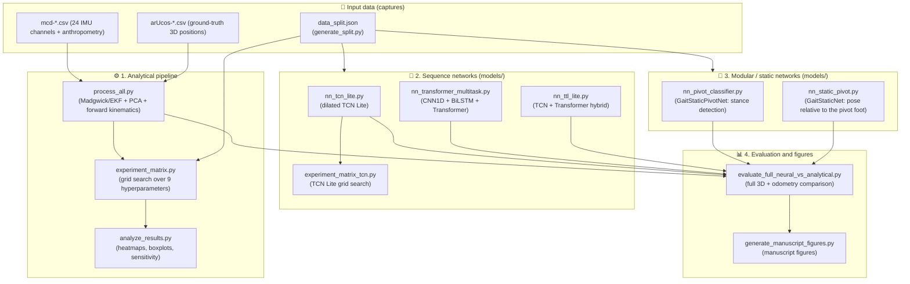

# 📚 Code guide: GaitTrackingProject
> **Motion-capture (MoCap) system and 3D kinematic reconstruction of human gait based on IMUs and deep learning.**

All commands are run from the repository root. The models live in the `models/` package and are launched with `python -m models.<name>`.

---

## 🧭 1. Project overview and architecture

The goal of the project is to reconstruct the 3D pose and the global trajectory of human lower-limb gait using only **4 inertial sensors (IMUs)** worn on the body (right thigh `RF`, left thigh `LF`, right shank `RT`, left shank `LT`) and **3 anthropometric measurements** (femur length, tibia length and hip width).

As the ground-truth reference (**ground truth / GT**), a computer-vision system based on **ArUco markers** placed on key joints (hips, knees and ankles) was used.

The project has two main branches:
1. **Classical analytical approach:** orientation filters (Madgwick / EKF), geometric alignment (Rodrigues, PCA), spherical interpolation (Slerp) and forward kinematics with a pivot-foot heuristic.
2. **Deep-learning approach (neural networks):**
   - **End-to-end sequence models:** estimate the 3D pose and the global odometry directly from the IMU time series (BiLSTM + Transformer, dilated TCN Lite, hybrid TTL).
   - **Modular / static models:** networks that split the problem into (a) classifying the stance foot (`GaitStaticPivotNet`) and (b) estimating the pose relative to the stance foot (`GaitStaticNet`).

---

## 🗺️ 2. Data flow and relationship between scripts

---

## 📖 3. Details of each code file

### 🟢 1. Analytical pipeline and classical processing

#### 📄 `process_all.py`
* **What is it?** The main script of the **traditional analytical pipeline**, and the base library imported by all the other scripts (file reading, filtering, kinematics and metrics).
* **What does it do, step by step?**
  1. **Reading and filtering:** reads the `mcd-*.csv` and `arUcos-*.csv` files. Applies a zero-phase Butterworth low-pass filter (`filtfilt`) to the inertial readings.
  2. **Orientation estimation:** runs sensor-fusion algorithms (**Madgwick** or **EKF**) to obtain orientation quaternions for each sensor (`RF`, `LF`, `RT`, `LT`).
  3. **Spatial alignment and calibration:**
     - Uses Rodrigues' rotation formula with the first samples at rest to align the vertical axis with gravity.
     - Applies **PCA (Principal Component Analysis)** to the data in motion to align the walking direction (yaw).
     - Performs spherical interpolation (**Slerp**) between the thigh orientations to derive the pelvis/hip orientation.
  4. **Forward kinematics and pivot foot (`mcd_reconstruction`):**
     - Decides which foot acts as anchor/pivot (stance phase) by comparing the relative Z height and the angular velocity of the shank (*swing override*).
     - Propagates the skeletal chain by adding the rotated bone vectors (femurs and tibias) from the stance foot up to the hip and down the opposite, swinging leg.
  5. **Evaluation metrics:** synchronizes in time with ArUco and interpolates to compute:
     - Mean 3D Euclidean error (MPJPE).
     - Mean absolute error (MAE).
     - Pearson correlation of the trajectories.
     - Knee flexion/extension angle.
     - Stride length and cadence detection (`detect_stride_lengths`).
     - Accumulated global displacement error.
  6. **Animation/visualization:** includes an `animation()` function to render the analytical skeleton vs ArUco in 3D.

#### 📄 `generate_split.py`
* **What does it do?** Generates `data_split.json` with the fixed split of subjects into training / validation / test. All the models and experiment matrices use this file so that the comparison is fair.

---

### 🧪 2. Parameter optimization and statistical analysis

#### 📄 `experiment_matrix.py`
* **What is it?** Grid-search script that optimizes the 9 key hyperparameters of the analytical pipeline (`process_all.py`).
* **What does it evaluate?**
  1. Butterworth cut-off frequency (`CUTOFF_FREQS`: [7, 9, 11, 13] Hz).
  2. Filter order (`FILTER_ORDERS`: [5, 6, 7]).
  3. PCA percentile for walking-direction detection (`PCA_PERCENTILES`: [5, 10, 20, 30]%).
  4. Madgwick filter gain (`MADGWICK_GAINS`: [0.01, 0.02, 0.033]).
  5. Clipping of the Slerp interpolation at the hip (`SLERP_CLIP_MINS`: [0.3, 0.5]).
  6. Static calibration samples (`CALIBRATION_SAMPLES_LIST`: [60, 70, 80, 100]).
  7. Orientation filter (`FUSION_FILTERS`: Madgwick vs EKF).
  8. Height threshold for the pivot switch (`PIVOT_HEIGHT_THRESHOLDS`: [0.005, 0.01, 0.015] m).
  9. Angular-velocity threshold for the *swing override* (`SWING_VELOCITY_THRESHOLDS`: [0.3, 0.5, 0.7] rad/s).
* **Size:** the full Cartesian product, 4 × 3 × 4 × 3 × 2 × 4 × 2 × 3 × 3 = 20,736 combinations. The EKF does not use the Madgwick gain, so the 3 gain values give identical EKF results and only 13,824 configurations are distinct.
* **Selected configuration** (`DEFAULT_VALS`): 9 Hz, order 6, 20th percentile, Madgwick gain 0.02, Slerp clip 0.3, 100 calibration samples, Madgwick, pivot threshold 0.005 m, swing threshold 0.3 rad/s.
* **Output:** runs the combinations with parallel processing (`multiprocessing.Pool`) and saves the results to `Results/experiment_matrix/experiment_matrix.csv`.

#### 📄 `analyze_results.py`
* **What does it do?** Reads the CSV of `experiment_matrix.py` and produces heatmaps, boxplots and a sensitivity analysis in `Results/analysis/`.

#### 📄 `experiment_matrix_tcn.py`
* **What is it?** Experiment matrix and grid search for the **TCN Lite** neural network (`models/nn_tcn_lite.py`).
* **Hyperparameters explored** in the committed results (`experiment_matrix_tcn.csv`, 42 runs). The search varied one factor (or the two subject counts together) at a time around lr 5e-4, batch 24, window 50, stride 3:
  1. `lr`: learning rate (`5e-5, 1e-4, 5e-4, 1e-3, 5e-3`).
  2. `batch_size`: batch size (`4, 8, 16, 24, 32, 48, 64, 128, 256`).
  3. `window_size`: temporal window length (`10, 15, 20, 25, 30, 35, 40, 45, 50` frames).
  4. `window_stride`: shift between consecutive windows (`2, 3, 5, 7, 10` frames).
  5. `n_test_subjects`: number of subjects in the test set (`2, 3, 5`).
  6. `n_val_subjects`: number of validation subjects (`2, 3, 5, 7, 9`).
* **Note:** `GRID_HYPERPARAMS` in the script now holds only the final configuration (lr 5e-4, batch 24, window 50, stride 3, 3 test and 3 validation subjects). To repeat the search, put the value lists above back into `GRID_HYPERPARAMS`. With `--analyze-only`, the script regenerates the plots from the committed CSV without training.
* **Outputs in `nn-results/experiment_matrix_tcn/`:**
  - Log file: `experiment_matrix_tcn.csv`.
  - Marginal-impact curves: `plots/hyperparam_trends.png`.
  - 2D heatmaps: `heatmaps/heatmap_lr_vs_batch_size.png`, `heatmaps/heatmap_window_size_vs_stride.png`.
  - Table of the top 10 models: `summary_table.png`.

---

### 🧠 3. Deep-learning models (`models/`)

All checkpoints are stored in `nn-results/<type>/checkpoints/`.

#### 📄 `models/nn_tcn_lite.py`
* **Architecture:** `GaitMultiTaskNetTCN` = **non-causal dilated TCN backbone (Temporal Convolutional Network, symmetric padding)** with residual connections and a multi-task head (3D pose + pelvic displacement).
* **Purpose:** complete, continuous 3D kinematic reconstruction of the lower limbs with low latency and high temporal efficiency. It is the model proposed in the manuscript.
* **Outputs:** 3D pose of 6 joints (18 values) + frame-to-frame translation `[dx, dy, dz]`.
* **Output directory:** `nn-results/tcn_lite/` (checkpoints in `nn-results/tcn_lite/checkpoints/best_tcn_lite.pt`).

#### 📄 `models/nn_ttl_lite.py`
* **Architecture:** `GaitMultiTaskNetTTLLite` = hybrid of **TCN + BiLSTM + Transformer Lite**.
* **Purpose:** combines the fast local feature extraction of the TCN with the long-range temporal attention of the Transformer.
* **Output directory:** `nn-results/ttl_lite/` (checkpoints in `nn-results/ttl_lite/checkpoints/best_ttl_lite.pt`).

#### 📄 `models/nn_transformer_multitask.py`
* **Architecture:** `GaitMultiTaskNet` = **Conv1D** + **BiLSTM** + **Transformer encoder** (self-attention) + multi-task linear heads.
* **Multi-task physical loss (`deep_multitask_loss`):** pose, displacement, accumulated trajectory, bone lengths, height above the ground and temporal smoothness.
* **Output directory:** `nn-results/transformer_multitask/` (checkpoints in `nn-results/transformer_multitask/checkpoints/best_multitask_model_trans.pt`).

#### 📄 `models/nn_pivot_classifier.py`
* **Architecture:** `GaitStaticPivotNet` (deep MLP) and `GaitTCNPivotNet` (1D TCN).
* **Purpose:** determine at every instant which foot is the stance pivot (1 = right, 0 = left) from the IMU readings.
* **Output directory:** `nn-results/pivot_classifier/` (checkpoints in `nn-results/pivot_classifier/checkpoints/best_pivot_classifier.pt`).

#### 📄 `models/nn_static_pivot.py`
* **Architecture:** `GaitStaticNet` = dense residual MLP centred on the current pivot foot.
* **Purpose:** predicts the 6 joints anchored to the stance foot, for a step-by-step cumulative global reconstruction.
* **Output directory:** `nn-results/static_pivot/` (checkpoints in `nn-results/static_pivot/checkpoints/best_static_model.pt`).

---

### 📊 4. Evaluation and manuscript figures

#### 📄 `evaluate_full_neural_vs_analytical.py`
* **What does it do?** The **final benchmarking script of the project**. It runs a rigorous comparison between all the implemented methods:
  1. **Traditional analytical method** (Madgwick + heuristic + kinematics).
  2. **Static modular neural pipeline** (`nn_pivot_classifier` + `nn_static_pivot` + `accumulate_global_trajectory`).
  3. **End-to-end sequence models** (`nn_transformer_multitask`, `nn_tcn_lite`, `nn_ttl_lite`).
* **Outputs:** produces synchronized 3D animations, plots and tables in `nn-results/full_neural_vs_analytical/`.

#### 📄 `generate_manuscript_figures.py`
* **What does it do?** Reuses the evaluation of `evaluate_full_neural_vs_analytical.py` and produces the final figures (PNG/PDF) in `v2_manuscript/figures/`. It keeps a cache (`eval_cache.pkl`) to avoid repeating the evaluation.

#### 📄 `benchmark_timing.py` and `reproducibility/`
* **What do they do?** `benchmark_timing.py` measures the execution time of the networks and of the analytical pipeline. The `reproducibility/` folder contains the scripts to reproduce the evaluation, the multi-seed retraining and the timing; see [`reproducibility/README.md`](../reproducibility/README.md).

---

## ⚡ 4. Summary table: "which script should I use?"

| If you want to... | Example command | Output folder / checkpoints |
| :--- | :--- | :--- |
| **Run the classical analytical method** (Madgwick + kinematics) | `python process_all.py` | `Results/` |
| **Generate the subject split** | `python generate_split.py` | `data_split.json` |
| **Optimize the analytical hyperparameters** (parallel grid search) | `python experiment_matrix.py` | `Results/experiment_matrix/` |
| **Plot heatmaps and the hyperparameter analysis** | `python analyze_results.py` | `Results/analysis/` |
| **Train the lightweight (non-causal) TCN network** | `python -m models.nn_tcn_lite --epochs 200` | `nn-results/tcn_lite/checkpoints/` |
| **Train the hybrid TCN + Transformer network** | `python -m models.nn_ttl_lite --epochs 200` | `nn-results/ttl_lite/checkpoints/` |
| **Train the BiLSTM + Transformer network** | `python -m models.nn_transformer_multitask` | `nn-results/transformer_multitask/checkpoints/` |
| **Train the stance-foot (pivot) classifier** | `python -m models.nn_pivot_classifier` | `nn-results/pivot_classifier/checkpoints/` |
| **Train the pivot-relative static network** | `python -m models.nn_static_pivot` | `nn-results/static_pivot/checkpoints/` |
| **Optimize the TCN Lite hyperparameters (grid search)** | `python experiment_matrix_tcn.py` | `nn-results/experiment_matrix_tcn/` |
| **Compare ALL the models (analytical vs NNs)** | `python evaluate_full_neural_vs_analytical.py` | `nn-results/full_neural_vs_analytical/` |
| **Generate the manuscript figures** | `python generate_manuscript_figures.py` | `v2_manuscript/figures/` |
| **Measure execution times** | `python benchmark_timing.py` | JSON file given by `--out` |
