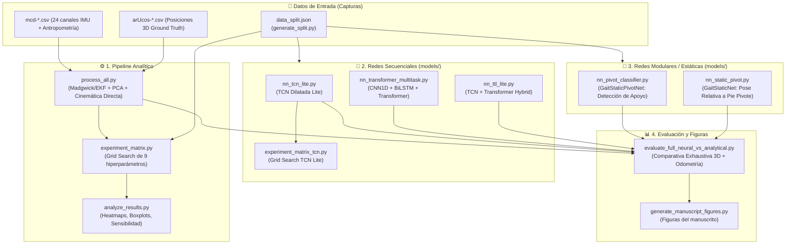

# 📚 Guía de Códigos del Proyecto: GaitTrackingProject
> **Sistema de Captura de Movimiento (MoCap) y Reconstrucción Cinemática 3D de la Marcha Humana basado en IMUs y Deep Learning.**

Todos los comandos se ejecutan desde la raíz del repositorio. Los modelos viven en el paquete `models/` y se lanzan con `python -m models.<nombre>`.

---

## 🧭 1. Resumen General del Proyecto y Arquitectura

El objetivo del proyecto es reconstruir la pose 3D y la trayectoria global de la marcha humana del tren inferior utilizando únicamente **4 sensores inerciales (IMUs)** montados en el cuerpo (Muslo Derecho `RF`, Muslo Izquierdo `LF`, Pantorrilla Derecha `RT`, Pantorrilla Izquierda `LT`) y **3 medidas antropométricas** (longitud de fémur, longitud de tibia y ancho de cadera).

Como referencia de verdad terreno (**Ground Truth / GT**), se utilizó un sistema de visión por computadora basado en **marcadores ArUco** colocados en articulaciones clave (caderas, rodillas y tobillos).

El proyecto tiene dos grandes vertientes:
1. **Enfoque Analítico Clásico:** Filtros de orientación (Madgwick / EKF), alineación geométrica (Rodrigues, PCA), interpolación esférica (Slerp) y cinemática directa con heurística de pie pivote.
2. **Enfoque de Deep Learning (Redes Neuronales):**
   - **Modelos Secuenciales End-to-End:** Estiman pose 3D y odometría global directamente desde la serie temporal de las IMUs (BiLSTM + Transformer, TCN Dilatada Lite, TTL Híbrido).
   - **Modelos Modulares / Estáticos:** Redes que desacoplan el problema en (a) clasificar el pie de apoyo (`GaitStaticPivotNet`) y (b) estimar la pose relativa respecto al pie de apoyo (`GaitStaticNet`).

---

## 🗺️ 2. Mapa del Flujo de Datos y Relación entre Scripts

---

## 📖 3. Detalle de Cada Archivo de Código

### 🟢 1. Pipeline Analítico y Procesamiento Clásico

#### 📄 `process_all.py`
* **¿Qué es?:** Es el script principal del **pipeline analítico tradicional** y la librería base que importan todos los demás scripts (lectura de archivos, filtrado, cinemática y métricas).
* **¿Qué hace paso a paso?:**
  1. **Lectura y Filtrado:** Lee archivos `mcd-*.csv` y `arUcos-*.csv`. Aplica un filtro pasa-bajas Butterworth de fase cero (`filtfilt`) a las lecturas inerciales.
  2. **Estimación de Orientación:** Ejecuta algoritmos de fusión sensorial (**Madgwick** o **EKF**) para obtener cuaterniones de orientación para cada sensor (`RF`, `LF`, `RT`, `LT`).
  3. **Alineación Espacial y Calibración:**
     - Usa la fórmula de rotación de Rodrigues con las primeras muestras en reposo para alinear el eje vertical con la gravedad.
     - Aplica **PCA (Principal Component Analysis)** sobre los datos en movimiento para alinear el eje de avance (Yaw) de la marcha.
     - Realiza interpolación esférica (**Slerp**) entre las orientaciones de los muslos para derivar la orientación de la pelvis/cadera.
  4. **Cinemática Directa y Pie Pivote (`mcd_reconstruction`):**
     - Evalúa cuál pie actúa como ancla/pivote (fase de apoyo o *stance*) comparando la altura Z relativa y la velocidad angular del giro de la pantorrilla (*swing override*).
     - Propaga la cadena esquelética sumando los vectores óseos rotados (fémures y tibias) desde el pie de apoyo hacia la cadera y hacia la pierna contraria en balanceo.
  5. **Métricas de Evaluación:** Sincroniza temporalmente con ArUco e interpola para calcular:
     - Error Euclidiano medio 3D (MPJPE).
     - Error Absoluto Medio (MAE).
     - Correlación de Pearson en trayectorias.
     - Ángulo de flexión/extensión de rodilla.
     - Detección de longitud y cadencia de zancadas (`detect_stride_lengths`).
     - Error de desplazamiento global acumulado.
  6. **Animación/Visualización:** Incluye una función `animation()` para renderizar en 3D el esqueleto analítico vs ArUco.

#### 📄 `generate_split.py`
* **¿Qué hace?:** Genera `data_split.json` con la división fija de sujetos en entrenamiento / validación / prueba. Todos los modelos y matrices de experimentación usan este archivo para que la comparación sea justa.

---

### 🧪 2. Optimización de Parámetros y Análisis Estadístico

#### 📄 `experiment_matrix.py`
* **¿Qué es?:** Script de búsqueda en cuadrícula (**Grid Search**) para optimizar los 9 hiperparámetros clave del pipeline analítico (`process_all.py`).
* **¿Qué evalúa?:**
  1. Frecuencia de corte Butterworth (`CUTOFF_FREQS`: [5, 7, 9, 11] Hz).
  2. Orden del filtro (`FILTER_ORDERS`: [4, 5, 6]).
  3. Percentil PCA para detección de avance (`PCA_PERCENTILES`: [5, 10, 20, 30]%).
  4. Ganancia del filtro Madgwick (`MADGWICK_GAINS`: [0.01, 0.02, 0.033]).
  5. Recorte de interpolación Slerp en cadera (`SLERP_CLIP_MINS`: [0.3, 0.5]).
  6. Muestras estáticas de calibración (`CALIBRATION_SAMPLES_LIST`: [60, 70, 80, 100]).
  7. Filtro de orientación (`FUSION_FILTERS`: Madgwick vs EKF).
  8. Umbral de altura para cambio de pivote (`PIVOT_HEIGHT_THRESHOLDS`: [0.005, 0.01, 0.015] m).
  9. Umbral de velocidad angular para *swing override* (`SWING_VELOCITY_THRESHOLDS`: [0.3, 0.5, 0.7] rad/s).
* **Salida:** Ejecuta las combinaciones usando procesamiento paralelo (`multiprocessing.Pool`) y guarda los resultados en `Results/experiment_matrix/experiment_matrix.csv`.

#### 📄 `analyze_results.py`
* **¿Qué hace?:** Lee el CSV de `experiment_matrix.py` y genera heatmaps, boxplots y análisis de sensibilidad en `Results/analysis/`.

#### 📄 `experiment_matrix_tcn.py`
* **¿Qué es?:** Matriz de experimentación y Grid Search para la red neuronal **TCN Lite** (`models/nn_tcn_lite.py`).
* **Hiperparámetros explorados:**
  1. `lr`: Tasa de aprendizaje (`1e-3, 5e-4, 1e-4`).
  2. `batch_size`: Tamaño del batch (`16, 32, 64`).
  3. `window_size`: Longitud de ventana temporal (`100, 150, 200` frames).
  4. `window_stride`: Desplazamiento/solapamiento (`15, 25, 50` frames).
  5. `n_test_subjects`: Número de sujetos en el conjunto de prueba (`2, 4`).
  6. `n_val_subjects`: Número de sujetos en validación (`2, 3`).
* **Salidas en `nn-results/experiment_matrix_tcn/`:**
  - Archivo de registro: `experiment_matrix_tcn.csv`.
  - Curvas de impacto marginal: `plots/hyperparam_trends.png`.
  - Mapas de calor 2D: `heatmaps/heatmap_lr_vs_batch_size.png`, `heatmaps/heatmap_window_size_vs_stride.png`.
  - Tabla del Top 10 mejores modelos: `summary_table.png`.

---

### 🧠 3. Modelos de Deep Learning (`models/`)

Todos los checkpoints se organizan en `nn-results/<tipo>/checkpoints/`.

#### 📄 `models/nn_tcn_lite.py`
* **Arquitectura:** `GaitMultiTaskNetTCN` = **Backbone TCN Dilatada no causal (Temporal Convolutional Network, padding simétrico)** con conexiones residuales y cabezal multitarea (Pose 3D + Desplazamiento pélvico).
* **Propósito:** Reconstrucción cinemática 3D completa y continua del tren inferior con baja latencia y alta eficiencia temporal. Es el modelo propuesto en el manuscrito.
* **Salidas:** Pose 3D de 6 articulaciones (18 valores) + traslación frame a frame `[dx, dy, dz]`.
* **Directorio de salida:** `nn-results/tcn_lite/` (checkpoints en `nn-results/tcn_lite/checkpoints/best_tcn_lite.pt`).

#### 📄 `models/nn_ttl_lite.py`
* **Arquitectura:** `GaitMultiTaskNetTTLLite` = Híbrido entre **TCN + BiLSTM + Transformer Lite**.
* **Propósito:** Combina la extracción local rápida de la TCN con la atención temporal de largo alcance del Transformer.
* **Directorio de salida:** `nn-results/ttl_lite/` (checkpoints en `nn-results/ttl_lite/checkpoints/best_ttl_lite.pt`).

#### 📄 `models/nn_transformer_multitask.py`
* **Arquitectura:** `GaitMultiTaskNet` = **Conv1D** + **BiLSTM** + **Transformer Encoder** (Self-Attention) + Cabezas Lineales multitarea.
* **Pérdida Física Multitarea (`deep_multitask_loss`):** Pose, desplazamiento, trayectoria acumulada, longitudes óseas, altura sobre el suelo y suavidad temporal.
* **Directorio de salida:** `nn-results/transformer_multitask/` (checkpoints en `nn-results/transformer_multitask/checkpoints/best_multitask_model_trans.pt`).

#### 📄 `models/nn_pivot_classifier.py`
* **Arquitectura:** `GaitStaticPivotNet` (MLP profundo) y `GaitTCNPivotNet` (TCN 1D).
* **Propósito:** Determinar en cada instante cuál pie es el pivote de apoyo / *stance* (1 = Derecho, 0 = Izquierdo) a partir de las lecturas IMU.
* **Directorio de salida:** `nn-results/pivot_classifier/` (checkpoints en `nn-results/pivot_classifier/checkpoints/best_pivot_classifier.pt`).

#### 📄 `models/nn_static_pivot.py`
* **Arquitectura:** `GaitStaticNet` = Red densa MLP residual centrada en el pie pivote actual.
* **Propósito:** Predice las 6 articulaciones ancladas al pie de apoyo para reconstrucción global acumulativa paso a paso.
* **Directorio de salida:** `nn-results/static_pivot/` (checkpoints en `nn-results/static_pivot/checkpoints/best_static_model.pt`).

---

### 📊 4. Evaluación y Figuras del Manuscrito

#### 📄 `evaluate_full_neural_vs_analytical.py`
* **¿Qué hace?:** Es el script de **benchmarking definitivo del proyecto**. Ejecuta una comparación rigurosa entre todos los métodos implementados:
  1. **Método Analítico Tradicional** (Madgwick + Heurística + Cinemática).
  2. **Pipeline Neuronal Modular Estático** (`nn_pivot_classifier` + `nn_static_pivot` + `accumulate_global_trajectory`).
  3. **Modelos Secuenciales End-to-End** (`nn_transformer_multitask`, `nn_tcn_lite`, `nn_ttl_lite`).
* **Salidas:** Genera animaciones 3D sincronizadas, gráficos y tablas en `nn-results/full_neural_vs_analytical/`.

#### 📄 `generate_manuscript_figures.py`
* **¿Qué hace?:** Reutiliza la evaluación de `evaluate_full_neural_vs_analytical.py` y genera las figuras finales (PNG/PDF, en español e inglés) en `v2_manuscript/figures/`. Guarda un caché (`eval_cache.pkl`) para no repetir la evaluación.

---

## ⚡ 4. Tabla Resumen: "¿Qué script debo usar?"

| Si quieres hacer esto... | Comando de ejemplo | Carpeta de Salida / Checkpoints |
| :--- | :--- | :--- |
| **Procesar el método analítico clásico** (Madgwick + Cinemática) | `python process_all.py` | `Results/` |
| **Generar la división de sujetos** | `python generate_split.py` | `data_split.json` |
| **Optimizar hiperparámetros analíticos** (Grid Search paralelo) | `python experiment_matrix.py` | `Results/experiment_matrix/` |
| **Graficar heatmaps y análisis de los hiperparámetros** | `python analyze_results.py` | `Results/analysis/` |
| **Entrenar la red TCN Ligera (no causal)** | `python -m models.nn_tcn_lite --epochs 200` | `nn-results/tcn_lite/checkpoints/` |
| **Entrenar la red Híbrida TCN + Transformer** | `python -m models.nn_ttl_lite --epochs 200` | `nn-results/ttl_lite/checkpoints/` |
| **Entrenar la red BiLSTM + Transformer** | `python -m models.nn_transformer_multitask` | `nn-results/transformer_multitask/checkpoints/` |
| **Entrenar el clasificador de pie de apoyo (Pivote)** | `python -m models.nn_pivot_classifier` | `nn-results/pivot_classifier/checkpoints/` |
| **Entrenar la red estática relativa al pivote** | `python -m models.nn_static_pivot` | `nn-results/static_pivot/checkpoints/` |
| **Optimizar hiperparámetros de TCN Lite (Grid Search)** | `python experiment_matrix_tcn.py` | `nn-results/experiment_matrix_tcn/` |
| **Comparar TODOS los modelos (Analítico vs NNs)** | `python evaluate_full_neural_vs_analytical.py` | `nn-results/full_neural_vs_analytical/` |
| **Generar las figuras del manuscrito** | `python generate_manuscript_figures.py` | `v2_manuscript/figures/` |
